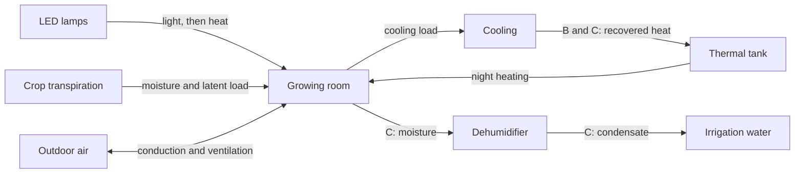
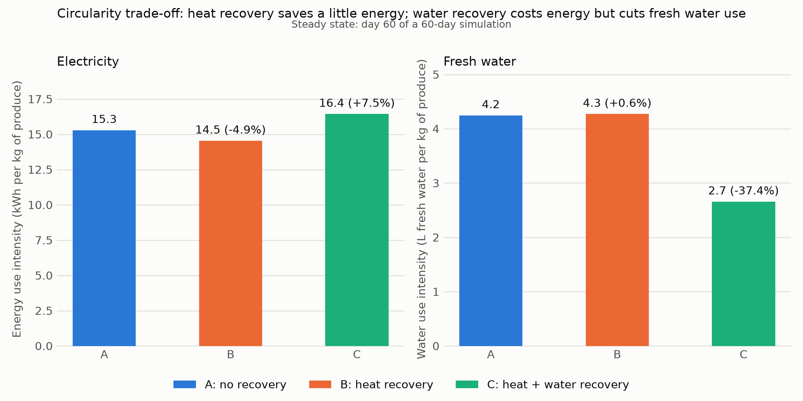
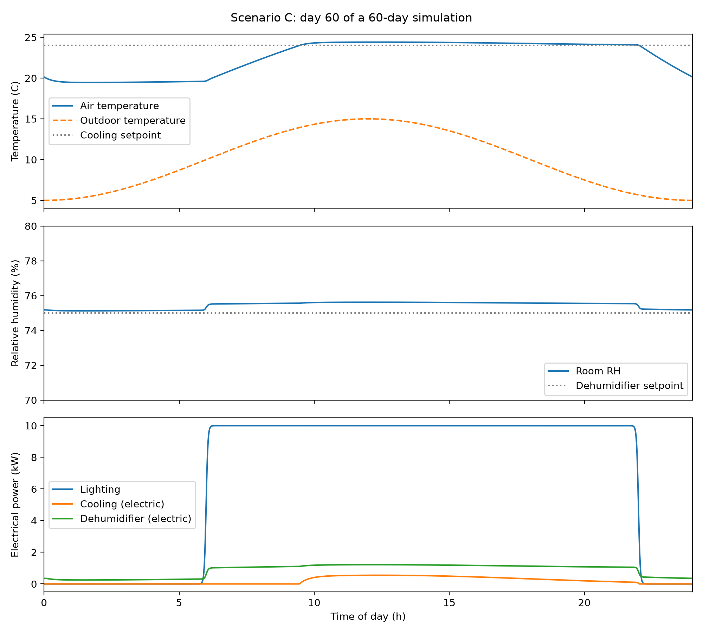
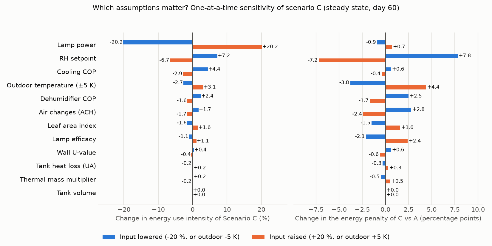

<h1 align="center">Circular CEA Energy Model</h1>

<p align="center">
  <b>What does it cost, in electricity and in water, to make a vertical-farm growing room circular?</b><br>
  A coupled energy and water balance simulation of a closed, lit, controlled-environment growing room.
</p>

<p align="center">
  
  
  
  
</p>

<p align="center">
  <a href="#key-findings">Findings</a> ·
  <a href="#the-model">Model</a> ·
  <a href="#verification-and-validation">Validation</a> ·
  <a href="#sensitivity">Sensitivity</a> ·
  <a href="#limitations">Limitations</a> ·
  <a href="#getting-started">Run it</a> ·
  <a href="#roadmap">Roadmap</a>
</p>

---

## Overview

A closed growing room turns almost all of its lighting electricity into heat, and its crop transpires several litres of water per kilogram of produce. A conventional ("linear") room cools the air, vents the humid air and throws both the heat and the water away. A circular room can capture both. Capturing them is not free, so the interesting question is the trade-off.

Three scenarios are compared under identical weather, lights and crop:

| | Scenario | What it does |
|---|---|---|
| **A** | Linear | No recovery. Waste heat is rejected, transpired water is vented, and the room is heated from the grid when it is cold. |
| **B** | Heat recovery | Heat removed by the cooling system is stored in a thermal buffer tank and later used to heat the room. |
| **C** | Heat and water recovery | As B, plus a dehumidifier that condenses transpired water for reuse in irrigation. |



This is a self-directed project on dynamic systems modelling for controlled-environment agriculture. It is a model study, **not** a calibrated or measured facility: see [Verification and validation](#verification-and-validation) and [Limitations](#limitations).

## Key findings

Steady state (last day of a 60-day run), one 100 m² room, 100 W/m² of LED lighting (daily light integral about 17 mol/m²/day), fixed yield of 13.3 kg/day.

| Scenario | Electricity (kWh/kg) | vs A | Fresh water (L/kg) | vs A | Electricity per floor area (kWh/m²/yr) |
|---|---|---|---|---|---|
| A: linear | 15.28 | n/a | 4.24 | n/a | 740 |
| B: heat recovery | 14.53 | -4.9 % | 4.27 | +0.6 % | 703 |
| C: heat and water recovery | 16.43 | +7.5 % | 2.65 | -37.4 % | 795 |

- **Water recovery pays in water, costs in electricity.** Scenario C recovers 68 % of transpired water and cuts fresh water use by 37 %, for 7.5 % more electricity, because dehumidifying is not free.
- **Heat recovery saves a few percent.** The saving is limited by how much heating the room needs at night, not by how much heat is available.
- **The size of the water-recovery penalty depends mainly on** the relative-humidity setpoint, outdoor temperature, air-change rate and the cooling and dehumidifier efficiencies. Tank size and thermal mass barely matter.
- **Absolute kWh/kg is not a robust result.** It scales with the assumed yield per lit area. The ratios between scenarios are the more reliable output.

<p align="center">
  
</p>

<p align="center">
  
</p>

## The model

Four states are integrated in time with a stiff ODE solver (`scipy`, BDF; relative tolerance 1e-6, 60 s output step):

```
Room air temperature   C_sys dT/dt = Q_lamp + Q_heat + Q_dehum_latent + Q_tank_loss
                                     - Q_envelope - Q_ventilation - Q_transpiration - Q_cool
Room humidity ratio    V dchi/dt   = M_crop - M_dehum - M_vent
Recovered water        dV_rec/dt   = M_dehum / rho_water
Tank temperature       C_tank dT_tank/dt = Q_charge - Q_discharge - Q_tank_loss
```

<details>
<summary><b>Submodels and indicators</b></summary>

- **Lighting:** electrical power density with a 16 h photoperiod. 98 % of lamp input becomes room heat; 2 % is stored in biomass. The optical share of the light drives transpiration.
- **Crop water use:** a simplified Penman-Monteith-type form, latent flux = a x absorbed light + b x LAI x vapour pressure deficit.
- **Envelope and ventilation:** conduction (U x A x dT) and infiltration (air changes per hour) against a sinusoidal outdoor temperature.
- **Climate control:** proportional cooling, heating and dehumidification with capacity limits.
- **Thermal buffer tank:** charge and discharge rates that taper smoothly near the temperature limits, a charging efficiency of 0.85 and a standing heat loss.
- **Electricity:** `P_total = P_lamp + Q_cool / COP_cool + M_dehum x latent_heat / COP_dehum + grid heating`.
- **Indicators:** energy use intensity (kWh per kg of produce), water use intensity (L of fresh water per kg), and the fraction of transpired water recovered.

Every input value and modelling choice is listed in [`docs/assumptions.md`](docs/assumptions.md).

</details>

## Verification and validation

Two questions are kept apart: does the code solve the equations correctly (verification), and do the equations and inputs resemble a real growing room (validation)? The full account is in [`docs/validation.md`](docs/validation.md).

| Check | Result |
|---|---|
| Water and tank energy balances | Close to 0.0002 %, against a test requirement of 0.1 % |
| Pinned reference results | Headline numbers of all three scenarios are fixed in a test, so any change fails loudly |
| Numerical convergence | Tighter tolerances and a finer output step change no indicator by more than 0.001 % |
| Literature plausibility | Lighting about 79 % of electricity (published 46 to 88 %); cooling plus dehumidification about 27 % of scenario C (12 to 42 %); 740 kWh/m²/yr in scenario A (517 to 773, one pilot farm); fresh water 2.7 to 4.2 L/kg (2 to 10) |

The literature comparison led to two corrections during development: lamp power density was reduced from 200 to 100 W/m² (the original daily light integral was about 2.5 times typical for lettuce), and lamp light is now counted as room heat. Both errors were invisible to the conservation tests, which is why the comparison is part of the process.

Energy per kg (15.3 kWh/kg) is above the lowest published values, mainly because the assumed yield per lit area is modest. **There has been no comparison with measurements from a real facility.** The literature values and how each was verified are in [`data/literature/literature_values.csv`](data/literature/literature_values.csv).

## Sensitivity

One-at-a-time changes of +/-20 % (outdoor temperature +/-5 K), reported as the change in scenario C's energy use and in its penalty relative to A. Across the cases run, the energy penalty of water recovery ranged from 0.3 % to 15 %.

<p align="center">
  
</p>

Lamp power dominates absolute energy use, as expected at a fixed yield. The relative-humidity setpoint is the largest driver of the penalty itself.

## Limitations

- Yield is fixed and independent of light, so lamp power and efficacy cannot change production. Energy per kg is therefore sensitive to the assumed yield.
- One well-mixed room: no spatial variation, no CO2 model, no fans or pumps, no real HVAC equipment curves.
- Proportional control leaves the air about 2 K above the cooling setpoint during the light period.
- Scenarios A and B have no humidity control, so room humidity can reach saturation, while C has a dehumidifier. C's energy penalty therefore compares a controlled room with an uncontrolled one.
- Synthetic weather (a single sinusoidal day), one mild site, no sunlight, and no economics or carbon accounting.
- The thermal tank is oversized for this room (a tank about a tenth of the size gives the same saving).
- No calibration against measured data.

## Getting started

```bash
git clone https://github.com/shrestharupeshh/circular-cea-energy-model.git
cd circular-cea-energy-model

conda env create -f environment.yml
conda activate cea

pytest                      # 8 tests, about 30 seconds
python run_multiday.py      # steady-state comparison of A, B and C
python run_sensitivity.py   # one-at-a-time sensitivity (several minutes)
python plot_tornado.py
python plot_scenario_comparison.py
python plot_daily_profile.py
```

Without conda: `pip install numpy scipy pandas matplotlib pytest`.

## Repository layout

```
src/                model code
  constants.py        physical constants
  psychro.py          saturation pressure, humidity, VPD
  lighting.py         lamp power and photoperiod
  envelope.py         conduction and ventilation
  crop.py             transpiration
  hvac.py             dehumidifier
  storage.py          thermal buffer tank
  model.py            the coupled ODE system
  scenarios.py        base case, the three scenarios, the runner
  indicators.py       energy and water indicators
tests/              pytest suite (psychrometrics, conservation, reference results)
docs/               assumptions.md, validation.md
data/               sensitivity results; literature/ holds the literature table
figures/            generated figures
run_*.py            scenario and analysis scripts
plot_*.py           figure scripts
check_*.py          stage-by-stage balance checks used while building the model
```

## Roadmap

| Version | Content |
|---|---|
| **1.0** (this release) | Three scenarios, tests, sensitivity, convergence, literature check, assumptions and validation documents |
| 1.1 | Automated literature comparison, sensitivity to the biomass heat fraction, system schematic |
| 2.0 | Humidity control in scenarios A and B; yield that responds to daily light integral; seasonal weather from a real site; fan, pump and other loads |
| 3.0 | Greenhouse variant with sunlight and supplemental lighting, to compare closed and sun-lit systems |
| Later | Calibration against measured pilot-farm data; cost and carbon accounting |

## References

- Graamans L., Baeza E., van den Dobbelsteen A., Tsafaras I., Stanghellini C. (2018). Plant factories versus greenhouses: comparison of resource use efficiency. *Agricultural Systems* 160, 31-43.
- Weidner T., Yang A., Hamm M.W. (2021). Energy optimisation of plant factories and greenhouses for different climatic conditions. *Energy Conversion and Management* 243, 114336.
- Barbosa G.L. et al. (2015). Comparison of land, water, and energy requirements of lettuce grown using hydroponic vs. conventional agricultural methods. *International Journal of Environmental Research and Public Health* 12(6), 6879-6891.
- Semenchuk (2025). *Energy modelling and analysis of vertical farming for vegetable production*. MSc thesis, University of Manitoba.
- Ceccanti, Bischi, Desideri, Baccioli (2025). arXiv:2507.18419 (preprint, not peer reviewed).
- NREL poster NREL/PO-6A20-82104 (vertical-farm lettuce water use).

## Author

**Rupesh Shrestha**, mechanical engineer (MEng, UC Berkeley). [shrestharupesh.com](https://www.shrestharupesh.com)

Project designed with the help of AI for the purpose of self training to learn system dynamic modeling in CEA. Built as a self-directed project on dynamic systems modelling for controlled-environment agriculture. The model structure follows a self-study guide. An AI assistant was used for explanation and code review; the code was written and run by the author.

